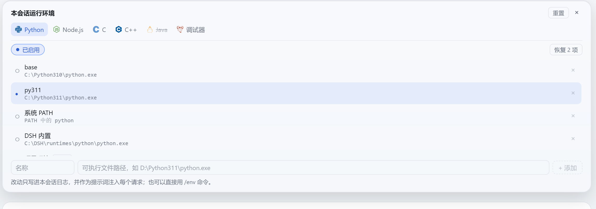

# DSH Ex Nihilo

**DSHEN** — DeepSeek Harness（[DSH](https://github.com/deepseek-ai/deepseek-harness)）的插件合集，从零逐件打造（*ex nihilo*）。

| 插件 | 做什么 | 装它 |
|---|---|---|
| **dshen-env-picker** | 输入框左下多一个环境按钮：按会话选 Python / Node.js / C / C++ / Java / GDB，选择写进提示词 | [说明](packages/dsh-env-picker) |
| **dshen-rewind** | 每一轮改文件前先留快照（`/rewind`）；归档的会话进回收站，可还原或彻底删除 | [说明](packages/dsh-rewind) |
| **dshen** | 套件：一次把上面这些装齐（目前仅支持从 npm 安装） | [说明](packages/dshen) |



## 安装

前提：DSH `0.2.2-rc.3` 及以上。装完**刷新一次页面**。

### 方式一：本地目录（不需要 npm，推荐）

1. 下载这个仓库：GitHub 页面右上 **Code → Download ZIP**，或者 `git clone https://github.com/Eaick/DSH-Ex-Nihilo.git`
2. 解压到任意位置
3. 打开 DSH：**插件 → 添加插件**，填/选插件目录：
   - 环境选择器：`<解压目录>\packages\dsh-env-picker`
   - 回收站/回滚：`<解压目录>\packages\dsh-rewind`
4. 刷新页面，输入框左下角出现环境按钮、侧边栏出现「回收站」

不想点界面的话，也可以对 agent 说：`install_bundle`，`target` 填这两个目录的绝对路径。

### 方式二：Git 地址（不想下载整仓）

DSH 的安装框也接受 pnpm 的 git 依赖写法。下面这组 commit 是**实际验证过能装上**的版本（`2ba8810`，含客户端修复）：

```
git+https://github.com/Eaick/DSH-Ex-Nihilo.git#2ba88103245da9f1f58337529986cccb7727cbc5&path:/packages/dsh-env-picker
git+https://github.com/Eaick/DSH-Ex-Nihilo.git#2ba88103245da9f1f58337529986cccb7727cbc5&path:/packages/dsh-rewind
```

说明两点，免得误会：

- 这串是**写给 DSH/pnpm 的安装 spec**，不是浏览器里能点的下载链接——复制到「插件 → 添加插件」的输入框里用；
- `#` 后面必须是**完整 40 位 commit**，`path:` 指到包目录；想装更新的代码，就换成仓库当前提交（网页提交页可复制，或本地 `git rev-parse HEAD`）。这种装法钉死 commit，不会被 `updateBundle` 自动跟踪。

### 方式三：npm（发布后）

npm 上发布后，装包名就行：

| 包名 | 说明 |
|---|---|
| `dshen` | 套件，一次装齐 |
| `dshen-env-picker` | 只要环境选择器 |
| `dshen-rewind` | 只要回滚 + 回收站 |

在「插件 → 添加插件」填 `dshen`（或 `dshen-env-picker@0.1.0`）。

> 套件 `dshen` 的依赖走 registry，因此**只能从 npm 装**，不能用方式二的 Git 地址装；未发布前请按方式一/二单独装两个插件。

## 兼容性

- DSH：每个包声明 `engines.dsh = ^0.2.2-rc.3`，版本不匹配时安装会被直接拒绝，而不是装上后崩溃。
- 平台：Web 客户端（`platform: web`）。
- 不需要构建步骤：`client.js` 就是浏览器可直接加载的模块。

## 许可

[MIT](LICENSE)。插件基于 DSH 的公开插件 API 实现，与 DeepSeek 官方无隶属关系。

---

### 给维护者

开发、测试、发布、改名的注意事项都写在 [CONTRIBUTING.md](CONTRIBUTING.md)，根 README 只面向安装者。
