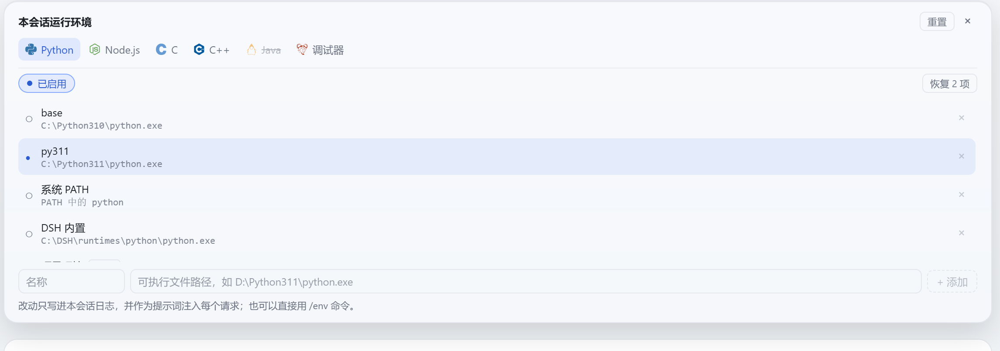

# dshen-env-picker

会话级运行环境选择器（DeepSeek Harness 插件）。为本会话选择 Python / Node.js / C / C++ / Java / GDB 环境，选择写进系统提示词，模型就知道该用哪个解释器、编译器和调试器。



## 功能

- **输入框左下角的按钮**显示所有已启用语言的当前环境；点开是浮层环境管理器（不挤压输入框，点外面或按 Esc 关闭）。
- **语言分页**：Python / Node.js / C / C++ / Java / 调试器，每页只管理一种语言。
- **自动检测**：conda 环境、PATH、DSH 自带运行时；MinGW/LLVM 的 gcc/g++/gdb；`JAVA_HOME` 与常见 JDK 目录。
- **手动增删**：名称 + 可执行文件路径即可添加；`×` 删除自定义项、隐藏自动检测项（不动磁盘），可一键恢复。
- **按语言开关**：关闭某语言后，它不进按钮、不进提示词、也不注入 `DSH_*` 变量。
- 所有改动只写进会话日志（既有 `command/run` 记录），fork / 重启 / 重放都能还原。

## 安装

三种方式（详见[仓库 README](https://github.com/Eaick/DSH-Ex-Nihilo#安装)）：

- **npm**（发布后）：在「插件 → 添加插件」填 `dshen-env-picker`；
- **本地目录**：下载仓库后，选 `packages/dsh-env-picker` 这个目录；
- **Git 地址**：填 `git+https://…/DSH-Ex-Nihilo.git#<40位commit>&path:/packages/dsh-env-picker`。

装完刷新页面，输入框左下角会出现环境按钮。

## 使用

- 点输入框左侧的环境按钮管理环境；
- 或直接用命令：

```
/env                              查看当前状态
/env python D2                    切换
/env add python "我的环境" C:\Python311\python.exe
/env remove python base           删除自定义项 / 隐藏检测项
/env show all python              恢复隐藏项
/env enable|disable java          开关某种语言
/env reset                        恢复默认（保留自定义项）
```

## 注入的提示词

```markdown
## 指定运行环境
我指定你在 Python 环境：D2（C:\Python311\python.exe），Node.js 环境：系统 PATH（PATH 中的 node），
C 环境：GCC 15.2.0（Scoop）（…\gcc.exe），C++ 环境：…（…\g++.exe），Java 环境：JDK 21.0.10（…\java.exe），
调试器 环境：GDB 17.1（…\gdb.exe）。

- Python：使用 `& "...\python.exe" ...`（也可用 `conda run -n D2 python ...`），不要调用 PATH 上的其它 python。
- C：编译用 `& "...\gcc.exe" ...`；编译前把该 bin 目录放到 PATH 前面。
- …
```

同时每次 shell 调用都带 `DSH_PYTHON` / `DSH_NODE` / `DSH_CC` / `DSH_CXX` / `DSH_GDB` / `DSH_JAVA` / `DSH_JAVA_HOME`。

## 限制

- 只影响 agent 的 shell 调用与提示词；集成终端、`workflow` 的 JS 沙箱不跟随。
- 子会话使用默认环境，不继承父会话选择。
- 自定义环境保存在当前会话；跨会话请写进插件 config，或使用套件中的后续插件。
- C/C++ 只探测 GCC/MinGW/LLVM 命令行工具链，不含 Visual Studio 的 `cl.exe`（需要 vcvars）。

更多细节见 [docs/DETAIL.md](docs/DETAIL.md)。

## 许可

[MIT](LICENSE)
